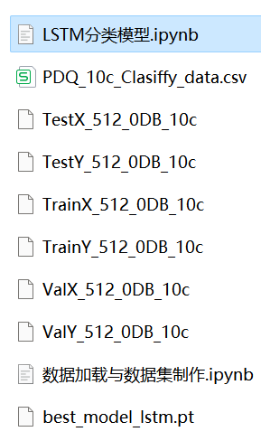

# Power Quality Disturbance Signal Classification: Pytorch-LSTM One-Dimensional Signal Classification

The translation provided is:

Includes a complete dataset of power quality disturbance signals, as well as a pre-generated dataset of ten types of disturbance signals, classified data, and label sets. The corresponding code can be run.
Includes code for data preprocessing and LSTM classification.
Environment: Python 3.9

Note: The actual code execution may vary depending on the specific implementation details.

## Images

<!-- PAYMENT_BLOCK -->

## Get this dataset

- Payment link (Stripe): [Buy now](https://buy.stripe.com/3cs8yP7sY87d0vu9AB)
- Payment QR code: 

<!-- /PAYMENT_BLOCK -->
